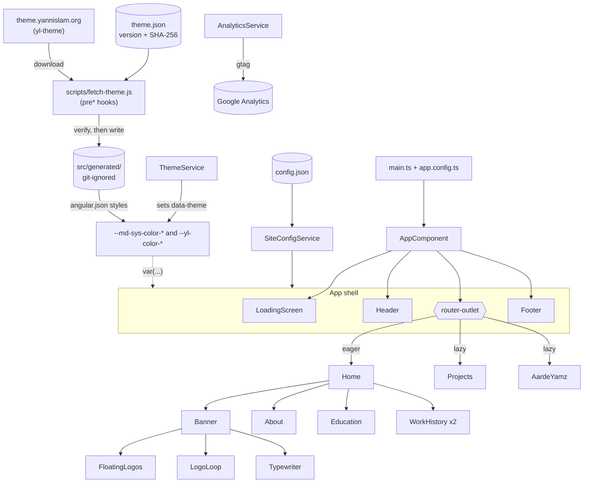
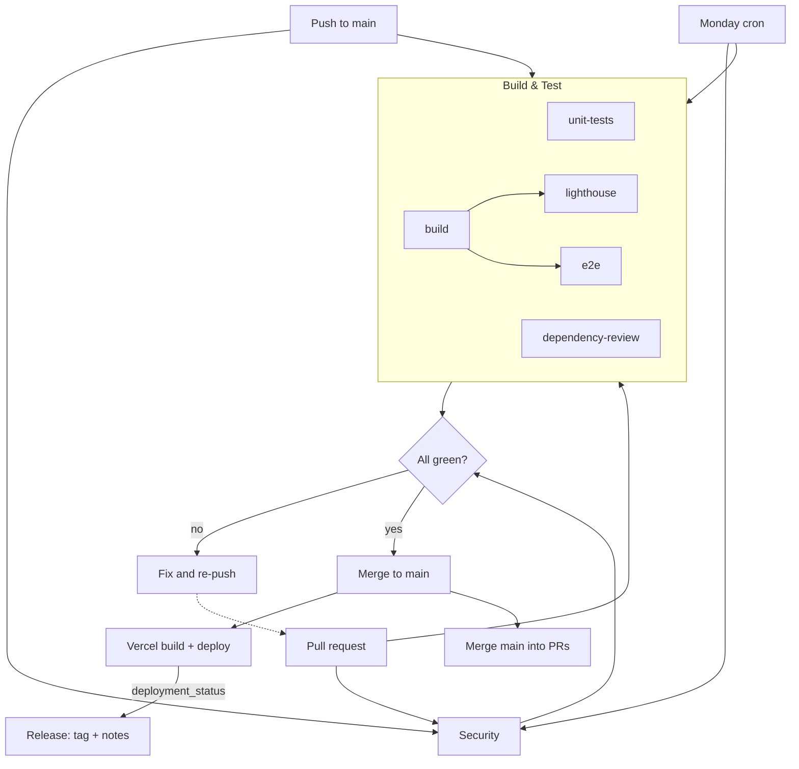
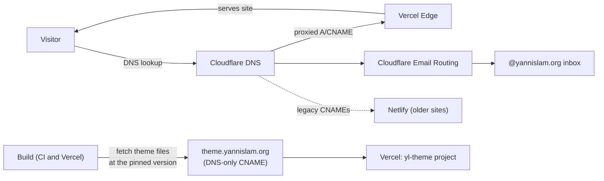

# Yannis Lam Portfolio Website v.3

[](https://angular.dev)
[](https://www.typescriptlang.org/)
[](https://nodejs.org/)
[](https://github.com/AardeYamz/v3.yannislam.org/actions/workflows/build-test.yml)
[](https://github.com/AardeYamz/v3.yannislam.org/actions/workflows/security.yml)
[](.github/dependabot.yml)
[](https://playwright.dev)
[](https://getbootstrap.com/)
[](https://vercel.com)
[](https://www.cloudflare.com/)
[](https://analytics.google.com/)
[](LICENSE)
[](LICENSE-CONTENT)

The source of [yannislam.org](https://yannislam.org): an Angular 22 portfolio
site, prerendered to static HTML and served from Vercel. Nearly all of the
page copy lives in one file, `src/assets/config.json`.

Lineage: forked from [Lê Thanh Tuấn's Portfolio](https://github.com/lethanhtuan939/Portfolio),
which was based on [José Hernández's](https://github.com/andresjosehr/andresjosehr-portfolio),
which was adapted from [Brittany Chiang's](https://github.com/bchiang7/v4).

This README is the working overview. [docs/reference.md](docs/reference.md) has the
full text of each section: component table, build hooks, e2e specs, CI jobs and workflows.

## Contents

- [Getting started](#getting-started)
- [Stack](#stack)
- [Architecture](#architecture)
- [Code structure](#code-structure)
- [Editing content (`config.json`)](#editing-content-configjson)
- [Testing](#testing)
- [CI/CD and deployment](#cicd-and-deployment)
- [Dependency security](#dependency-security)
- [Related repos](#related-repos)
- [Further documentation](#further-documentation)

## Getting started

You need [Node.js](https://nodejs.org/) 24 or 26 (CI runs both). The Angular
CLI is a dev dependency, so `npx ng …` works without a global install.

```bash
npm install
npm start            # dev server at http://localhost:4200, reloads on save
npm run build        # prerender every route + postbuild env substitution
npm test             # Vitest unit tests (watch; add -- --no-watch for one run)
npm run test:scripts # node --test for scripts/*.test.js
npm run test:e2e     # Playwright end-to-end tests
npm run test:perf    # Lighthouse CI (mobile; test:perf:desktop for desktop)
```

`start`, `build`, `watch`, `test` and `test:e2e` first run two pre-hooks:
`generate-resume-manifest.js` points the resume link at the newest dated PDF
in `src/assets/resume/`, and `fetch-theme.js` downloads the pinned theme files
into `src/generated/` (so the first run, and the first after a theme bump,
needs `theme.yannislam.org` to be reachable). After `build`, `inject-env.js`
fills in the Google Analytics ID from `GOOGLE_ANALYTICS_ID`; locally it falls
back to an inert placeholder and warns. Details:
[Build hooks](docs/reference.md#build-hooks).

## Stack

- **Framework:** Angular 22 with standalone components, signals, zoneless
  change detection, client hydration and a service worker; `@angular/ssr`
  prerenders every route at build time. TypeScript 6, strict mode plus
  `strictTemplates`.
- **UI:** Bootstrap 5 and ng-bootstrap 21; colour tokens (Material Design 3
  `--md-sys-color-*` roles plus `--yl-color-*`) from the shared yl-theme;
  inline SVG icons in `src/app/icons/` instead of Font Awesome;
  ngx-owl-carousel-o for the work history carousel; anime.js 4 for the
  boot-time logo animation. Hand-written: the banner typewriter, falling
  logos and logo loop, scroll reveal (`AosDirective`), hover link previews and
  placeholder logos (`LogoFallbackDirective`).
- **Analytics:** Google Analytics 4 through the `gtag.js` tag in
  `src/index.html` (`AnalyticsService` sends custom events only), plus Vercel
  Web Analytics and Speed Insights.
- **Hosting:** Vercel builds and serves the site (`vercel.json` also sets the
  security headers, including a report-only CSP); Cloudflare holds the DNS
  zone and routes `@yannislam.org` email.

## Architecture

`src/main.ts` bootstraps `AppComponent` with the providers in
`src/app/app.config.ts`. Components read content only through
`SiteConfigService`. `ThemeService` sets `[data-theme]` on `<html>`; the
colours themselves come from `yl-tokens.css`, fetched from yl-theme at the
version pinned in `theme.json`. Component by component:
[docs/reference.md](docs/reference.md#architecture).



### Routes

Defined in `src/app/app.routes.ts`. `src/app/app.routes.server.ts` lists the
same paths for prerendering and must be kept in step.

| Path | Loaded | Component |
|---|---|---|
| `''` | Eager | `HomeComponent` |
| `projects` | Lazy (`loadComponent`) | `ProjectsComponent` |
| `projects/highschool` | Lazy | `ProjectsHighschoolComponent` |
| `aardeyamz` | Lazy | `AardeYamzComponent` |
| `**` | | Redirects to `/` |

## Code structure

```
.github/          workflows, dependabot.yml, pull_request_template.md
docs/             change write-ups, plans, reviews (see docs/README.md)
e2e/              Playwright specs + fixtures.ts
scripts/          fetch-theme.js, generate-resume-manifest.js, inject-env.js (+ tests)
src/app/
  components/     general/ (header, footer, loading-screen), home/ (sections), other/aardeyamz/
  directives/     aos, link-preview, logo-fallback
  icons/          inline SVG icon registry + <app-icon>
  services/       site-config, theme, analytics, resume, scroll, seo
  app.routes.ts   routes (app.routes.server.ts: the prerender list)
src/assets/       config.json, resume-manifest.json, fonts/, images/, resume/
src/generated/    theme tokens, logos and favicons from yl-theme (git-ignored)
theme.json        pinned yl-theme version + SHA-256 per file
vercel.json       response headers, including the report-only CSP
```

Every component follows the Angular trio (`.ts` / `.html` / `.scss`, plus a
`.spec.ts`). The full tree: [docs/reference.md](docs/reference.md#code-structure).

## Editing content (`config.json`)

Nearly everything on the page comes from
[`src/assets/config.json`](src/assets/config.json); to reuse this site you
mostly edit only that file. Its shape is typed in
`src/app/services/site-config/site-config.model.ts`, but nothing validates the
JSON at build time, so keep new entries in the same shape as their neighbours.

| Key | What it holds |
|---|---|
| `siteMenu` | Nav items (`navTitle`, `siteLocation`, optional section anchors) |
| `logos`, `logoAbout` | Organization logos and shared "about" blurbs, referenced by `logoKey` |
| `about` | Name, email, `contact` links, the `aardeyamz` cards, and `experiences` (work, volunteering, education, skills) |
| `banner` | Greeting, name, blurb and the typewriter strings |
| `footer` | Repo link, "built with" credit, design credits |
| `projects` | The `college` and `highschool` project lists |
| `ui` | Interface text the templates use (labels, buttons, headings) |
| `siteTitle`, `heading`, `subHeading`, `manifest*` | `<title>` and PWA manifest fields |

A new social icon must exist in `src/app/icons/icon-registry.ts`. Field by
field: [docs/reference.md](docs/reference.md#editing-content-configjson).

## Testing

- **Unit (Vitest):** `npm test -- --no-watch` runs once, as CI does; add
  `--coverage` for coverage, or run one spec with
  `ng test --include='**/header.component.spec.ts'`. Vitest runs in
  Playwright's Chromium (`npx playwright install chromium`).
- **End-to-end (Playwright):** the specs in `e2e/` cover the boot sequence,
  the home sections, navigation, theme switching, the project pages, the
  resume download, links, mobile layout and assets. Install browsers once with
  `npx playwright install --with-deps chromium firefox webkit`; use
  `npm run test:e2e:ui` to write specs and `npm run test:e2e:report` for the
  last run. Wait for the app with `gotoAndSettle()` from `e2e/fixtures.ts`,
  never `waitForTimeout()`.
- **Performance (Lighthouse CI):** `npm run test:perf` (mobile) and
  `npm run test:perf:desktop` check a production build against the budgets in
  `lighthouserc.js`; CI runs both presets on every PR.

## CI/CD and deployment



- **Build & Test** (`build-test.yml`): unit tests on Node 24 and 26 (coverage
  to Codecov), the prerendered build, Lighthouse (mobile and desktop) and
  Playwright in two shards against that build, and dependency review on PRs.
  PRs run Chromium and a mobile context; pushes to `main` and the Monday run
  add Firefox and WebKit. A newer push to a PR cancels its older run.
- **Security** (`security.yml`): lints the workflow files with zizmor.
- **Deploy:** the Vercel Git integration deploys `main` to production and
  other branches as previews. **Release** then tags `vYYYYMMDD-HHMMSS` on each
  successful production deploy.
- **PR previews** (`pr-previews.yml`): every open PR is built with
  `--base-href /pr-N/` and published at `v3.yannislam.org/pr-N/`.
- **Housekeeping:** `sync-prs.yml` merges `main` into open PRs that are
  behind; `dependabot-auto-merge.yml` merges safe Dependabot bumps once their
  checks pass; `build-test.yml` and `vercel-build-warnings.yml` keep the
  Actions and Vercel build warnings in sticky PR comments. CodeQL runs as
  GitHub default setup.

Every workflow, trigger and job: [docs/reference.md](docs/reference.md#cicd-and-deployment).

### DNS and delivery



## Dependency security

[Dependabot](https://docs.github.com/en/code-security/dependabot) opens weekly
`npm` and `github-actions` updates (Mondays 06:00 UTC, with a cooldown) and
security updates. Bumps are grouped: `angular` (packages that must move
together), `testing`, and a `minor-and-patch` catch-all; other majors arrive
one per PR. Angular majors are ignored by Dependabot and done by hand with
`ng update`. [Aikido](https://www.aikido.dev) triages advisories by
reachability as a GitHub App set up in its own dashboard; there is no Aikido
job or secret in this repo.

## Related repos

These three are private, so their links work only for the owner.

| Repo | Relationship |
|---|---|
| [yl-theme](https://github.com/AardeYamz/yl-theme) | Serves `yl-tokens.css`, the logos, `logo-geometry.json` and the favicons from `theme.yannislam.org`; the version and SHA-256 are pinned in `theme.json` |
| [personal-dns](https://github.com/AardeYamz/personal-dns) | Cloudflare DNS for `yannislam.org` (the Vercel records, the `theme` and `v3` hosts, email MX), plus redirects |
| [yannislam.org](https://github.com/AardeYamz/yannislam.org) | The earlier Gatsby site; the `projects` content in `config.json` was ported from it |

## Further documentation

| Doc | What |
|---|---|
| [docs/reference.md](docs/reference.md) | The full reference: every section above in detail |
| [docs/README.md](docs/README.md) | Index of change write-ups, plans and reviews |
| [CLAUDE.md](CLAUDE.md), [AGENTS.md](AGENTS.md) | Conventions for agents and people changing the code |
| [CONTRIBUTING.md](CONTRIBUTING.md), [SECURITY.md](SECURITY.md), [CODE_OF_CONDUCT.md](CODE_OF_CONDUCT.md) | Contributing, reporting vulnerabilities, conduct |
