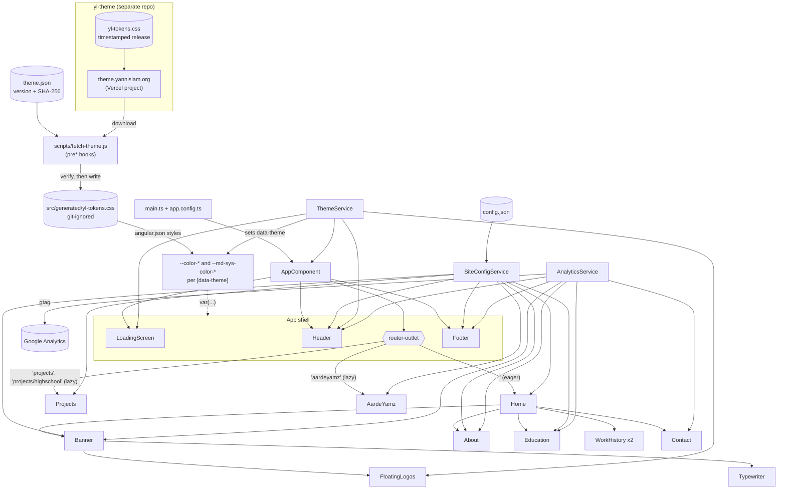
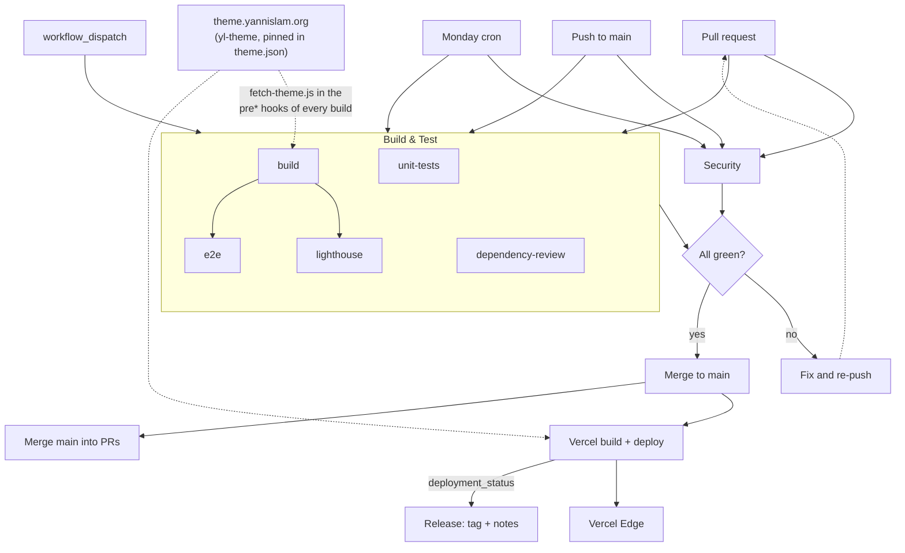
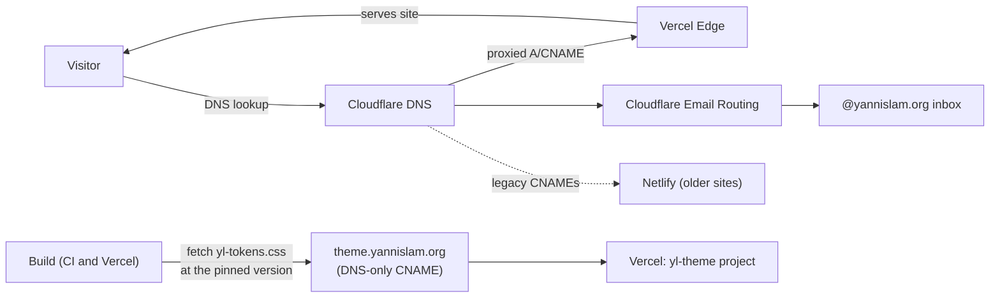

# Yannis Lam Portfolio Website v.3

[](https://angular.dev)
[](https://www.typescriptlang.org/)
[](https://nodejs.org/)
[](https://github.com/AardeYamz/v3.yannislam.org/actions/workflows/build-test.yml)
[](https://github.com/AardeYamz/v3.yannislam.org/actions/workflows/security.yml)
[](.github/dependabot.yml)
[](https://playwright.dev)
[](https://getbootstrap.com/)
[](https://vercel.com)
[](https://www.cloudflare.com/)
[](https://analytics.google.com/)
[](LICENSE)

The source of [yannislam.org](https://yannislam.org): an Angular 22 portfolio
site, prerendered to static HTML and served from Vercel. Nearly all of the
page copy lives in one file, `src/assets/config.json`.

Generated with Angular CLI 19 and since upgraded to 22. Lineage:

- Forked from [Lê Thanh Tuấn's Portfolio](https://github.com/lethanhtuan939/Portfolio)
- which was based on [José Hernández's Portfolio](https://github.com/andresjosehr/andresjosehr-portfolio)
- which was adapted from [Brittany Chiang's Portfolio](https://github.com/bchiang7/v4)

## Contents

- [Getting started](#getting-started)
- [Stack](#stack)
- [Architecture](#architecture)
- [Code structure](#code-structure)
- [Editing content (`config.json`)](#editing-content-configjson)
- [Testing](#testing)
- [CI/CD and deployment](#cicd-and-deployment)
- [Dependency security](#dependency-security)
- [Further documentation](#further-documentation)

## Getting started

You need [Node.js](https://nodejs.org/) 24 or 26 (CI runs both). The Angular
CLI is a dev dependency, so `npx ng …` works without a global install.

```bash
npm install
npm start            # dev server at http://localhost:4200, reloads on save
npm run build        # production build: prerender every route + postbuild env substitution
npm test             # Karma + Jasmine unit tests (watch mode)
npm run test:e2e     # Playwright end-to-end tests
npm run test:perf    # Lighthouse CI (mobile preset; test:perf:desktop for desktop)
```

`npm run build` fills in the Google Analytics ID from the `GOOGLE_ANALYTICS_ID`
environment variable (see [Build hooks](#build-hooks)). Locally it falls back
to an inert placeholder and warns.

## Stack

**Framework and language**

- [Angular](https://angular.dev) 22: standalone components, signals,
  zoneless change detection (`provideZonelessChangeDetection`), client
  hydration and a service worker (`@angular/service-worker`)
- `@angular/ssr`: every route is prerendered to static HTML at build time
  (`src/app/app.routes.server.ts`)
- TypeScript 6, strict mode plus `strictTemplates`

**UI**

- [Bootstrap](https://getbootstrap.com/) 5 and
  [ng-bootstrap](https://ng-bootstrap.github.io/) 21 for layout, nav and dropdowns
- Material Design 3 color tokens (`--md-sys-color-*`) alongside the site's own
  `--color-*` palette, in the shared `yl-tokens.css` (fetched from
  yl-theme per `theme.json` into `src/generated/`, with the logos)
- Inline SVG icons (`src/app/icons/`): the dozen Font Awesome glyphs the site
  uses, inlined instead of loading the Font Awesome CSS and webfonts
- [ngx-owl-carousel-o](https://www.npmjs.com/package/ngx-owl-carousel-o) for
  the work history carousel
- [anime.js](https://animejs.com) 4 for the boot-time logo animation
- Hand-written pieces: a signal-driven typewriter in the banner (replaced
  `ngx-typed-js`), a `requestAnimationFrame` loop of falling logo marks behind
  the banner, a scroll-reveal directive (`AosDirective`), hover link previews
  (`link-preview`), and a `LogoFallbackDirective` that draws a placeholder logo
  from an organization's name

**Analytics**

- Google Analytics 4 through the global `gtag.js` tag in `src/index.html`.
  `AnalyticsService` sends custom events only; GA4's enhanced measurement
  tracks page views. No analytics npm package is used.
- Vercel Web Analytics and Speed Insights (`@vercel/analytics`,
  `@vercel/speed-insights`), injected in `AppComponent`

**Hosting**

- [Vercel](https://vercel.com) builds and serves the site (`vercel.json`,
  which also sets the security headers, including a report-only CSP)
- [Cloudflare](https://www.cloudflare.com/) holds the `yannislam.org` DNS zone,
  proxies to Vercel, and handles email routing for `@yannislam.org`

## Architecture



| Piece | Kind | What it does |
|---|---|---|
| `main.ts` + `app.config.ts` | Bootstrap | `bootstrapApplication(AppComponent)` with zoneless change detection, router, hydration and the service worker |
| `LoadingScreenComponent` | Shell | Boot-time anime.js logo assembly |
| `HeaderComponent` | Shell | Nav bar, scroll effects and the theme toggle |
| `FooterComponent` | Shell | Repo link, "built with" credit, design credits |
| `HomeComponent` | Page (eager) | Composes the home sections on `/` |
| `BannerComponent` | Home section | Hero greeting, typewriter, falling logos |
| `AboutComponent`, `EducationComponent`, `ContactComponent` | Home sections | Read their copy from `SiteConfigService` |
| `WorkHistoryComponent` (x2) | Home section | One instance for work, one for volunteering |
| `ProjectsComponent`, `ProjectsHighschoolComponent` | Pages (lazy) | `/projects` and `/projects/highschool` |
| `AardeYamzComponent` + `NamecardComponent` | Page (lazy) | `/aardeyamz` |
| `SiteConfigService` | Service | The only reader of `config.json`, typed by `site-config.model.ts` |
| `ThemeService` | Service | `default` / `light` / `dark` modes, as signals, saved in `localStorage` and applied as `[data-theme]` on `<html>`. The colors themselves are not here: they come from `yl-tokens.css` (below) |
| `yl-tokens.css` | Dependency | Color tokens from the separate [yl-theme](https://github.com/AardeYamz/yl-theme) project. `theme.json` pins a version and SHA-256; `scripts/fetch-theme.js` downloads it, and the eleven logos, from `theme.yannislam.org` into git-ignored `src/generated/` before every start, build, test and e2e run; `angular.json` loads the tokens as a global stylesheet and serves the logos at `assets/images/logos/` |
| `AnalyticsService` | Service | Calls the global `gtag()` for custom events |
| `ResumeService` | Service | Builds the resume download link from `resume-manifest.json` |

### Routes

Defined in `src/app/app.routes.ts`; `src/app/app.routes.server.ts` lists the
same paths for prerendering and must be kept in step.

| Path | Loaded | Component |
|---|---|---|
| `''` | Eager | `HomeComponent` |
| `projects` | Lazy (`loadComponent`) | `ProjectsComponent` |
| `projects/highschool` | Lazy | `ProjectsHighschoolComponent` |
| `aardeyamz` | Lazy | `AardeYamzComponent` |
| `**` | | Redirects to `/` |

## Code structure

```
.github/
├── workflows/                # see "CI/CD and deployment"
├── dependabot.yml
└── pull_request_template.md
docs/                         # see docs/README.md
e2e/                          # Playwright specs + fixtures.ts
scripts/
├── generate-resume-manifest.js   # pre-hook: newest dated resume PDF -> resume-manifest.json
└── inject-env.js                 # postbuild: GA measurement ID into index.html
src/
├── app/
│   ├── animations/           # Shared Angular animation triggers (fade-stagger)
│   ├── components/
│   │   ├── general/          # header, footer, loading-screen
│   │   ├── home/             # banner (+ typewriter), floating-logos, about, education,
│   │   │                     # workhistory, contact, projects, projects-highschool
│   │   └── other/aardeyamz/  # /aardeyamz page (+ namecard)
│   ├── directives/           # aos, link-preview, logo-fallback
│   ├── icons/                # Inline SVG icon registry + <app-icon>
│   ├── pipes/linkify/        # Turns plain-text URLs into links
│   ├── services/             # site-config, theme, analytics, resume
│   ├── utils/hydration.ts    # SSR/hydration helpers
│   ├── app.config.ts         # Browser providers
│   ├── app.config.server.ts  # Server (prerender) providers
│   ├── app.routes.ts         # Routes
│   └── app.routes.server.ts  # Prerender list
├── assets/
│   ├── config.json           # All page content
│   ├── resume-manifest.json  # Written by the pre-hook
│   ├── fonts/  images/  resume/
├── generated/                # yl-tokens.css (color tokens per [data-theme]) and logos/<variant>.svg, fetched from yl-theme (git-ignored; see theme.json)
├── styles.scss               # Global styles
├── bootstrap-custom.scss     # Bootstrap overrides
├── fonts.scss                # @font-face (Calibre, SF Mono)
├── index.html                # gtag bootstrap, %GOOGLE_ANALYTICS_ID% placeholder
├── main.ts / main.server.ts
└── server.ts                 # Express entry for `outputMode: server` (not used by Vercel)
```

Every component follows the Angular trio (`.ts` / `.html` / `.scss`, plus a
`.spec.ts`). Components read content through `SiteConfigService`, never by
importing `config.json`.

### Build hooks

- **`scripts/generate-resume-manifest.js`** runs before `start`, `build`,
  `watch` and `test`. It finds the newest `src/assets/resume/<name> YYYYMMDD.pdf`
  and writes its filename to `src/assets/resume-manifest.json`, so dropping in a
  new dated PDF updates the download link with no code change. The manifest is
  tracked in git; commit it with the new PDF.
- **`scripts/inject-env.js`** runs after `build` and replaces
  `%GOOGLE_ANALYTICS_ID%` in the built `index.html`. On Vercel (`VERCEL=1`) a
  missing or malformed ID fails the build; elsewhere it writes the inert
  placeholder `G-XXXXXXXXXX` and warns. `ALLOW_MISSING_ANALYTICS=1` lets a fork
  build on Vercel without an ID.

## Editing content (`config.json`)

Nearly everything on the page comes from
[`src/assets/config.json`](src/assets/config.json). To reuse this site you
mostly only edit that file. Its shape is typed in
`src/app/services/site-config/site-config.model.ts`, but nothing validates the
JSON at build time, so keep new entries in the same shape as their neighbours.

| Key | What it holds |
|---|---|
| `siteMenu` | Nav items: `navTitle`, `siteLocation` (route or `/#anchor`), optional `navNumber` / `navContent` / `scrollSection` |
| `logos` | Map of `{ src, alt }`, referenced by `logoKey` from work, education and volunteering entries. With no `logoKey` or an empty `src`, a placeholder logo is drawn from the organization's name |
| `about` | `first` / `last` name, `email`, the `contact` list (each with an `icon` key such as `fa-linkedin` from the icon registry, and a `link`), and the `aardeyamz` name-meaning cards |
| `about.experiences` | `work` and `volunteering`, each a `list` of `organization`, `title`, `timeframe`, `description[]`, `skills[]` (optional `logoKey`, `link`, `about`, `tab`); a top-level `education` array of the same shape; a flat `skills` summary |
| `banner` | `greeting`, `name`, `blurb`, and the `typeSection` strings the typewriter cycles through |
| `footer` | Repo link, "built with" credit, `designCredits` |
| `projects.college`, `projects.highschool` | Each a `list` of `{ imgs[], title, timeframe, description[], link? }` |
| `siteTitle`, `heading`, `subHeading`, `manifest*` | `<title>` and PWA manifest fields |

Image `src` values can be a URL or a path under `src/assets/`. A new social
icon must exist in `src/app/icons/icon-registry.ts`. The dev server picks up
edits on save.

## Testing

### Unit tests (Karma + Jasmine)

```bash
npm test                                             # watch mode
npm test -- --watch=false --browsers=ChromeHeadless  # single run, as CI does
npm test -- --watch=false --code-coverage            # with coverage
ng test --include='**/header.component.spec.ts'      # one spec
```

Karma needs Chrome or Chromium. If it isn't found, point `CHROME_BIN` at a
binary, e.g. `CHROME_BIN=/opt/pw-browsers/chromium`. CI uploads coverage from
the Node 24 leg to [Codecov](https://codecov.io).

### End-to-end tests (Playwright)

Unit tests stub child components, so page composition, the boot sequence,
navigation and theme switching are covered by Playwright specs in `e2e/`
against the real app.

```bash
npx playwright install --with-deps chromium firefox webkit   # once per machine
npm run test:e2e            # headless
npm run test:e2e:ui         # interactive UI mode, best for writing specs
npm run test:e2e:report     # last run's HTML report (traces, screenshots, video)
```

Locally, Playwright starts (or reuses) `ng serve`. In CI it serves the `build`
job's `dist/v3.yannislam.org/browser` output through a static server with SPA
fallback, which is what Vercel deploys.

| Spec | Covers |
|---|---|
| `smoke` | Boot sequence (loading overlay, header mounts, scroll restored), `<title>`, no console errors or failed same-origin requests on any route |
| `home-sections` | Each home section renders the content from `config.json` |
| `navigation` | Nav scroll-to-section and route clicks, hard loads of every route, the `**` redirect, back/forward |
| `theme` | The `default → light → dark` cycle recolors the DOM, persists across reload, follows `prefers-color-scheme` |
| `projects`, `resume`, `footer-and-links`, `responsive`, `assets` | Project pages, resume download, footer and external links (tagged `@external`, run only on the weekly schedule), mobile layout, asset loading |

When adding a spec, never `waitForTimeout()` past the loading screen: use
`gotoAndSettle()` from `e2e/fixtures.ts`, which waits for the header nav. The
same fixture blocks analytics requests and isolates the service worker.

### Performance (Lighthouse CI)

`npm run test:perf` (mobile, slow 4G and 4× CPU) and `npm run test:perf:desktop`
run Lighthouse against a production build with the budgets in
`lighthouserc.js`. CI runs both presets on every PR.

## CI/CD and deployment



### Build & Test jobs (`build-test.yml`)

| Job | Runs on | Needs | What it does |
|---|---|---|---|
| `unit-tests` | Node 24.x and 26.x | | `npm ci`, then Karma in `ChromeHeadless` with coverage; uploads to Codecov from the 24.x leg |
| `build` | Node 24.x | | `npm run build`, prerendering every route; uploads the output as an artifact |
| `lighthouse` | `mobile`, `desktop` | `build` | Lighthouse CI against the build artifact |
| `e2e` | 2 shards, `fail-fast: false` | `build` | Playwright against the build artifact (browsers cached on `package-lock.json`). PRs run Chromium and a mobile (Pixel 7) context and skip `@external`; pushes to `main` and the Monday run add Firefox and WebKit |
| `dependency-review` | PRs only | | `actions/dependency-review-action`, fails on `high` or above |

A newer push to the same PR cancels the older run
(`concurrency: cancel-in-progress`). Pushes to `main` are never cancelled.

### Workflows

| Workflow | Trigger | What it does |
|---|---|---|
| [Build & Test](.github/workflows/build-test.yml) | PR to `main`/`master`/`develop`; push to `main`; Mondays 07:00 UTC; manual | The jobs above |
| [Security](.github/workflows/security.yml) | Same, Mondays 06:30 UTC | Lints the workflow files with zizmor |
| [Release](.github/workflows/release.yml) | Vercel `deployment_status` | On a successful Production deploy of `main`, tags `vYYYYMMDD-HHMMSS` and creates a release for that commit |
| [Merge main into PRs](.github/workflows/sync-prs.yml) | Push to `main`; manual | Merges `main` into each open PR that is behind; comments once on conflicts; skips fork and Dependabot PRs |
| [Dependabot auto-merge](.github/workflows/dependabot-auto-merge.yml) | `pull_request_target` | Waits for checks, then merges Dependabot patch/minor bumps and dev-only majors; production majors wait for review |
| [Vercel build warnings](.github/workflows/vercel-build-warnings.yml) | Vercel `deployment_status` | Fetches a preview deploy's Vercel build log and keeps its warning/error lines in a sticky PR comment (needs `VERCEL_TOKEN`) |
| [Dependabot](.github/dependabot.yml) | Mondays 06:00 UTC | Weekly `npm` and `github-actions` updates |
| CodeQL | Push, PR | GitHub default setup (no workflow file) |
| Vercel Git integration | Push to any branch | Production deploy for `main`, preview deploy for other branches |

The Monday jobs are staggered (Dependabot 06:00, Security 06:30, Build & Test
07:00) so each sees what the one before it produced.

### DNS and delivery



| Concern | Provider | Details |
|---|---|---|
| DNS zone | Cloudflare | `yannislam.org` |
| Site | Vercel | Proxied `A`/`CNAME` records point at Vercel Edge, which serves `dist/v3.yannislam.org/browser` |
| Email | Cloudflare Email Routing | MX/SPF/DKIM/DMARC for `@yannislam.org` |
| Legacy sites | Netlify | `alpha.`, `v1.` and `v2.` still point at earlier versions of the site |
| Theme tokens | Vercel (`yl-theme` project) | `theme.yannislam.org` is a DNS-only CNAME to Vercel. The build downloads the pinned `yl-tokens.css` from it, so a build needs that host to be reachable |

## Dependency security

- **[Dependabot](https://docs.github.com/en/code-security/dependabot)** opens
  the bump PRs: weekly version updates from `.github/dependabot.yml` (with a
  cooldown), and security updates from the repository settings, batched by the
  `security-updates` group.
- **[Aikido](https://www.aikido.dev)** triages them: it checks whether an
  advisory is reachable from shipped code, so a critical advisory in an
  unreachable dev dependency doesn't drown out real ones. It runs as a GitHub
  App with PR gating set in the Aikido dashboard; there is no Aikido job or
  secret in this repo.

Bumps are grouped: `angular` (the `@angular/*` packages and libraries tied to
an Angular major, which must move together), `testing`, and a
`minor-and-patch` catch-all. Other majors arrive one per PR so each can be
reverted alone. Angular majors are ignored by Dependabot and upgraded by hand
with `ng update`.

## Further documentation

- [`CLAUDE.md`](CLAUDE.md): conventions for agents (and people) changing the code
- [`docs/README.md`](docs/README.md): index of change write-ups, open plans and reviews
- [`AGENTS.md`](AGENTS.md): the short version of `CLAUDE.md` for any AI coding agent
- [`CONTRIBUTING.md`](CONTRIBUTING.md), [`SECURITY.md`](SECURITY.md), [`CODE_OF_CONDUCT.md`](CODE_OF_CONDUCT.md)
