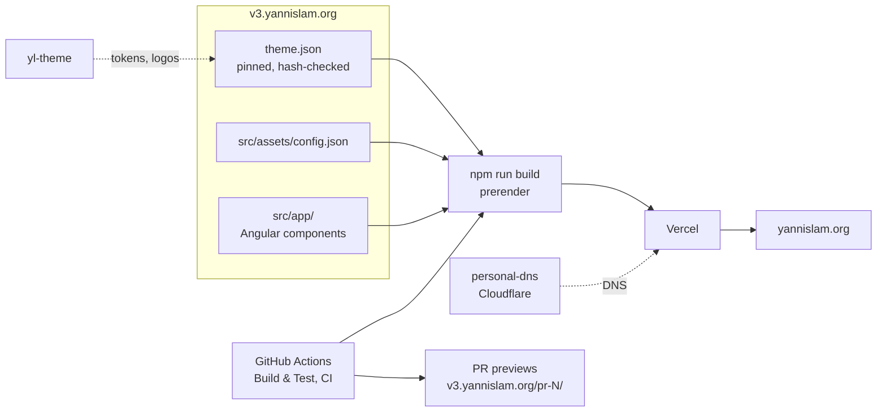

# Yannis Lam Portfolio Website v.3

[](https://angular.dev)
[](https://www.typescriptlang.org/)
[](https://nodejs.org/)
[](https://github.com/AardeYamz/v3.yannislam.org/actions/workflows/build-test.yml)
[](https://github.com/AardeYamz/v3.yannislam.org/actions/workflows/ci.yml)
[](.github/dependabot.yml)
[](https://playwright.dev)
[](https://getbootstrap.com/)
[](https://vercel.com)
[](https://www.cloudflare.com/)
[](https://analytics.google.com/)
[](LICENSE)
[](LICENSE-CONTENT)

The source of [yannislam.org](https://yannislam.org): a public Angular 22 portfolio, prerendered to static HTML and served from Vercel. Nearly all page copy lives in `src/assets/config.json`, with translations in `config.zh.json`, `config.hk.json`. Forked from [Lê Thanh Tuấn's Portfolio](https://github.com/lethanhtuan939/Portfolio), based on [José Hernández's](https://github.com/andresjosehr/andresjosehr-portfolio), adapted from [Brittany Chiang's](https://github.com/bchiang7/v4).

## Architecture



The full picture is in [`docs/diagrams/architecture.svg`](docs/diagrams/architecture.svg) (source: [`architecture.d2`](docs/diagrams/architecture.d2)).

- **App:** standalone components, signals, zoneless, `@angular/ssr` prerendering. Routes: `/`, `/projects`, `/projects/highschool`, `/aardeyamz`; keep `app.routes.ts` and `app.routes.server.ts` in step. Components read content only through `SiteConfigService`.
- **Build hooks:** before start, build, watch, test and e2e, `generate-resume-manifest.js` links the newest dated resume PDF and `fetch-theme.js` downloads the theme files pinned in `theme.json` from `theme.yannislam.org`. After build, `inject-env.js` fills in `GOOGLE_ANALYTICS_ID` (required on Vercel; `ALLOW_MISSING_ANALYTICS=1` lets a fork skip it).
- **Deploy:** Vercel builds `main` for production and every branch as a preview (`vercel.json` sets the security headers); each production deploy is tagged and released. `vercel-build-warnings.yml` needs `VERCEL_TOKEN`.
- **Dependencies:** weekly Dependabot bumps with auto-merge for patch, minor and dev majors; Aikido triages advisories. Angular majors are upgraded by hand with `ng update`.

## Code structure

```
.github/
├── workflows/                # see wiki/CI-CD-and-Deployment.md
├── actionlint.yaml           # actionlint config
├── dependabot.yml
├── pr-previews/              # PR preview support files
└── pull_request_template.md
docs/                         # see docs/README.md
e2e/                          # Playwright specs + fixtures.ts
scripts/
├── fetch-theme.js                # pre-hook: yl-theme files at the theme.json pin -> src/generated/
├── generate-resume-manifest.js   # pre-hook: newest dated resume PDF -> resume-manifest.json
├── inject-env.js                 # postbuild: GA measurement ID into index.html
└── *.test.js                     # node --test (npm run test:scripts)
src/
├── app/
│   ├── components/
│   │   ├── general/          # header, footer, loading-screen
│   │   ├── home/             # banner (+ typewriter), floating-logos, logo-loop, about,
│   │   │                     # education, workhistory, contact, projects, projects-highschool
│   │   └── other/aardeyamz/  # /aardeyamz page (+ namecard)
│   ├── directives/           # aos, fade-stagger, link-preview, logo-fallback
│   ├── icons/                # Inline SVG icon registry + <app-icon>
│   ├── pipes/linkify/        # Turns plain-text URLs into links
│   ├── services/             # site-config, language, theme, analytics, resume, scroll, seo
│   ├── utils/hydration.ts    # SSR/hydration helpers
│   ├── app.config.ts         # Browser providers
│   ├── app.config.server.ts  # Server (prerender) providers
│   ├── app.routes.ts         # Routes
│   └── app.routes.server.ts  # Prerender list
├── assets/
│   ├── config.json           # All page content (English)
│   ├── config.zh.json        # The same content in Simplified Chinese
│   ├── config.hk.json        # The same content in Traditional Chinese (Hong Kong)
│   ├── resume-manifest.json  # Written by the pre-hook
│   ├── fonts/  images/  resume/
├── generated/                # yl-tokens.css (color tokens per [data-theme]), logos/<variant>.svg, logo-geometry.json and favicons/, fetched from yl-theme (git-ignored; see theme.json)
├── styles.scss               # Global styles
├── variables.scss            # SCSS aliases ($Primary, $Surface…) for the theme tokens
├── bootstrap-custom.scss     # Bootstrap overrides
├── fonts.scss                # @font-face (Calibre, SF Mono)
├── index.html                # gtag bootstrap, %GOOGLE_ANALYTICS_ID% placeholder
├── main.ts / main.server.ts
└── server.ts                 # Express entry for `outputMode: server` (not used by Vercel)
wiki/                         # GitHub wiki pages (published from here)
theme.json                    # pinned yl-theme version + SHA-256 per file
vercel.json                   # response headers, including the report-only CSP
```

Every component follows the Angular trio (`.ts` / `.html` / `.scss`, plus a
`.spec.ts`). Components read content through `SiteConfigService`, never by
importing `config.json`.

## Editing content (`config.json`)

Nearly all page content is in [`src/assets/config.json`](src/assets/config.json).

| Key | Holds |
|---|---|
| `siteMenu` | Nav items |
| `about` | Name, email, contact links, name-meaning cards and `experiences` (work, volunteering, education, skills) |
| `logos`, `logoAbout` | Logos and organization blurbs, matched by `logoKey` |
| `banner`, `footer` | Hero text and typewriter strings; footer links and credits |
| `projects` | College and high school projects |
| `ui` | Interface text (none goes in templates) |
| `siteTitle`, `heading`, `subHeading`, `manifest*` | Page title and PWA manifest fields |

The Chinese edition is [`src/assets/config.zh.json`](src/assets/config.zh.json), a
translation with exactly the same keys and list lengths (a unit test checks
this). Edit all three files together (`config.hk.json` is
[`config.zh.json`](src/assets/config.zh.json) converted to Traditional characters with
Hong Kong wording, see
[`docs/changes/20261105-120000-hong-kong-edition.md`](docs/changes/20261105-120000-hong-kong-edition.md)). See
[`docs/changes/20261104-041538-chinese-edition.md`](docs/changes/20261104-041538-chinese-edition.md).

Match the shape of neighbouring entries: it is typed in `site-config.model.ts`, but the build does not validate the JSON. New social icons also go in `src/app/icons/icon-registry.ts`. Field-by-field detail: [Editing Content](wiki/Editing-Content.md).

## Related repos

| Repo | Role |
|---|---|
| [yl-theme](https://github.com/AardeYamz/yl-theme) (private) | color tokens, logos and favicons |
| [workflows](https://github.com/AardeYamz/workflows) | shared CI workflows and diagram linters |
| [personal-dns](https://github.com/AardeYamz/personal-dns) (private) | Cloudflare DNS and email routing |
| [yannislam.org](https://github.com/AardeYamz/yannislam.org) (private) | the earlier Gatsby site |

## Getting started

You need Node.js 24 or 26 (CI runs both).

```bash
npm install
npm start            # dev server at http://localhost:4200, reloads on save
npm run build        # prerender every route
```

The first `start` downloads the theme files, so `theme.yannislam.org` must be reachable. A local build without `GOOGLE_ANALYTICS_ID` warns and uses a placeholder. More in [Getting Started](wiki/Getting-Started.md).

## Testing

```bash
npx playwright install --with-deps chromium firefox webkit   # once per machine
npm test -- --no-watch   # Vitest unit tests, one run (plain npm test watches)
npm run test:scripts     # tests for the build scripts
npm run test:e2e         # Playwright; test:e2e:ui for interactive mode
npm run test:perf        # Lighthouse CI; test:perf:desktop for desktop
```

Unit tests stub child components, so page composition, navigation and theming are covered by the Playwright specs in `e2e/`. In new specs, wait with `gotoAndSettle()` from `e2e/fixtures.ts`, not `waitForTimeout()`. More in [Testing](wiki/Testing.md).

## Docs

- [Wiki](https://github.com/AardeYamz/v3.yannislam.org/wiki) (source in [`wiki/`](wiki/)): architecture and component diagrams, `config.json`, testing, CI/CD schedule and DNS.
- [docs/README.md](docs/README.md): index of change write-ups, plans and reviews.
- [CLAUDE.md](CLAUDE.md), [AGENTS.md](AGENTS.md): conventions and rules.
- [CONTRIBUTING.md](CONTRIBUTING.md), [SECURITY.md](SECURITY.md), [CODE_OF_CONDUCT.md](CODE_OF_CONDUCT.md).
- Code is [MIT](LICENSE); content is [CC BY 4.0](LICENSE-CONTENT).
