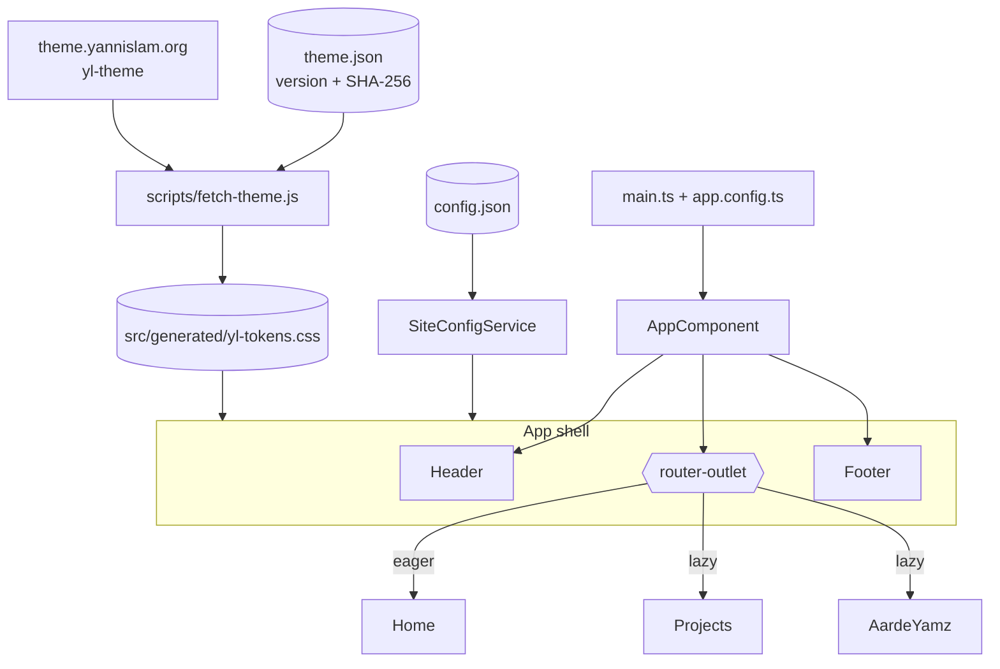
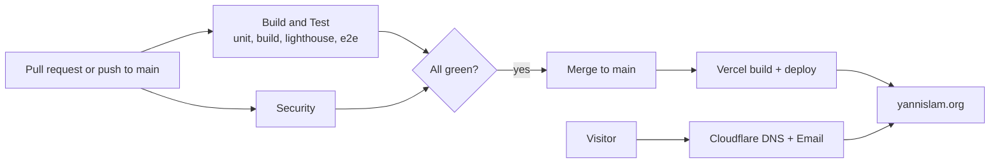

# Yannis Lam Portfolio Website v.3

[](https://angular.dev)
[](https://www.typescriptlang.org/)
[](https://github.com/AardeYamz/v3.yannislam.org/actions/workflows/build-test.yml)
[](https://github.com/AardeYamz/v3.yannislam.org/actions/workflows/security.yml)
[](https://vercel.com)
[](LICENSE)
[](LICENSE-CONTENT)

The source of [yannislam.org](https://yannislam.org): an Angular 22 portfolio site, prerendered to static HTML and served from Vercel. Nearly all page copy lives in one file, `src/assets/config.json`.

Lineage: forked from [Lê Thanh Tuấn's Portfolio](https://github.com/lethanhtuan939/Portfolio), based on [José Hernández's](https://github.com/andresjosehr/andresjosehr-portfolio), adapted from [Brittany Chiang's](https://github.com/bchiang7/v4).

## Architecture

Standalone components, signals and zoneless change detection; every route is prerendered by `@angular/ssr`. Routes: `/` (eager), `/projects` and `/projects/highschool`, `/aardeyamz` (lazy). Config comes from `config.json` through `SiteConfigService`; the theme comes from the [yl-theme](https://github.com/AardeYamz/yl-theme) repo, fetched at the pinned version in `theme.json`.

Full architecture, code structure and build hooks: [docs/reference.md](docs/reference.md#architecture).





## Related repos

| Repo | Relationship |
|---|---|
| [yl-theme](https://github.com/AardeYamz/yl-theme) | Supplies `yl-tokens.css` and the logos, pinned in `theme.json` |
| [personal-dns](https://github.com/AardeYamz/personal-dns) | DNS, redirects and email routing for `yannislam.org` |
| [workflows](https://github.com/AardeYamz/workflows) | Shared CI: diagram lint, zizmor, PR sync, Dependabot auto-merge |
| [yannislam.org](https://github.com/AardeYamz/yannislam.org), [v3.yannislam.org-gatsby](https://github.com/AardeYamz/v3.yannislam.org-gatsby) | Earlier versions of the site |

## Getting started

Node.js 24 or 26 (CI runs both).

```bash
npm install
npm start            # dev server at http://localhost:4200
npm run build        # prerender every route + postbuild env substitution
npm test             # Vitest unit tests
npm run test:e2e     # Playwright
npm run test:perf    # Lighthouse CI
```

`npm run build` fills in the Google Analytics ID from `GOOGLE_ANALYTICS_ID`; locally it uses an inert placeholder and warns.

## More

| Doc | What |
|---|---|
| [docs/reference.md](docs/reference.md) | Stack, routes, code structure, build hooks, testing, CI/CD, DNS, dependency security |
| [docs/README.md](docs/README.md) | Index of change write-ups, plans and reviews |
| [CLAUDE.md](CLAUDE.md), [AGENTS.md](AGENTS.md) | Conventions for agents and people changing the code |
| [CONTRIBUTING.md](CONTRIBUTING.md), [SECURITY.md](SECURITY.md) | Contributing and reporting vulnerabilities |
