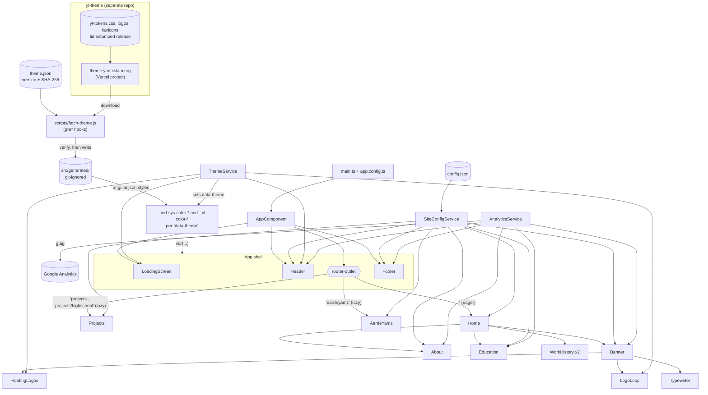

# Architecture

The whole system on one page, from the theme fetch and build hooks through the app to CI and delivery: [`docs/diagrams/architecture.svg`](https://github.com/AardeYamz/v3.yannislam.org/blob/main/docs/diagrams/architecture.svg) (source: [`architecture.d2`](https://github.com/AardeYamz/v3.yannislam.org/blob/main/docs/diagrams/architecture.d2), in [D2](https://d2lang.com)). The diagrams below zoom in on each part.

`src/main.ts` bootstraps `AppComponent` with the providers in
`src/app/app.config.ts`. Components read content only through
`SiteConfigService`. `ThemeService` sets `[data-theme]` on `<html>`; the
colours themselves come from `yl-tokens.css`, fetched from yl-theme at the
version pinned in `theme.json`.

| Piece | Kind | What it does |
|---|---|---|
| `main.ts` + `app.config.ts` | Bootstrap | `bootstrapApplication(AppComponent)` with zoneless change detection, router, hydration and the service worker |
| `LoadingScreenComponent` | Shell | Boot-time anime.js logo assembly |
| `HeaderComponent` | Shell | Nav bar, scroll effects and the theme toggle |
| `FooterComponent` | Shell | Repo link, "built with" credit, design credits |
| `HomeComponent` | Page (eager) | Composes the home sections on `/` |
| `BannerComponent` | Home section | Hero greeting, typewriter, falling logos (`FloatingLogosComponent`) and the drawn logo mark (`LogoLoopComponent`) |
| `AboutComponent`, `EducationComponent` | Home sections | Read their copy from `SiteConfigService` |
| `ContactComponent` | Home section (not mounted) | Not in `HomeComponent`'s template; its copy is still in `config.json` and covered by its unit test |
| `WorkHistoryComponent` (x2) | Home section | One instance for work, one for volunteering |
| `ProjectsComponent`, `ProjectsHighschoolComponent` | Pages (lazy) | `/projects` and `/projects/highschool` |
| `AardeYamzComponent` + `NamecardComponent` | Page (lazy) | `/aardeyamz` |
| `SiteConfigService` | Service | The only reader of `config.json` / `config.zh.json` (whichever `LanguageService` selects), typed by `site-config.model.ts` |
| `LanguageService` | Service | `en` / `zh` as a signal, saved in `localStorage`; a `zh.*` hostname, then a Chinese browser language or time zone, default to Chinese; everyone else gets English. The header button opens a dropdown of flags |
| `ThemeService` | Service | `default` / `light` / `dark` modes, as signals, saved in `localStorage` and applied as `[data-theme]` on `<html>`. The colors themselves are not here: they come from `yl-tokens.css` (below) |
| `yl-tokens.css` | Dependency | Color tokens from the separate [yl-theme](https://github.com/AardeYamz/yl-theme) project. `theme.json` pins a version and SHA-256; `scripts/fetch-theme.js` downloads it, the eleven logos and `logo-geometry.json` (which the loading screen and banner mark draw from) and the favicons, from `theme.yannislam.org` into git-ignored `src/generated/` before every start, build, test and e2e run; `angular.json` loads the tokens as a global stylesheet and serves the logos at `assets/images/logos/` |
| `AnalyticsService` | Service | Calls the global `gtag()` for custom events |
| `ResumeService` | Service | Builds the resume download link from `resume-manifest.json` |
| `ScrollService` | Service | One passive, rAF-throttled scroll listener exposed as signals, shared by the header and footer |
| `SeoService` | Service | Keeps the canonical URL and `og:url` / `twitter:url` in step with the current route |

## Routes

Defined in `src/app/app.routes.ts`. `src/app/app.routes.server.ts` lists the
same paths for prerendering and must be kept in step.

| Path | Loaded | Component |
|---|---|---|
| `''` | Eager | `HomeComponent` |
| `projects` | Lazy (`loadComponent`) | `ProjectsComponent` |
| `projects/highschool` | Lazy | `ProjectsHighschoolComponent` |
| `aardeyamz` | Lazy | `AardeYamzComponent` |
| `**` | | Redirects to `/` |

## Theme tokens

Colour tokens and logos come from the separate [yl-theme](https://github.com/AardeYamz/yl-theme) project, not this repo. `theme.json` pins a version and SHA-256; `scripts/fetch-theme.js` (run by the `pre*` hooks) downloads `yl-tokens.css`, the eleven logos, `logo-geometry.json` and the favicons from `theme.yannislam.org` into git-ignored `src/generated/`. `angular.json` loads the tokens as a global stylesheet. To change a token, change it in yl-theme, then here run `node scripts/fetch-theme.js --bump`, rebuild and commit `theme.json`.

## Code structure

See [Code structure](https://github.com/AardeYamz/v3.yannislam.org/blob/main/README.md#code-structure) in the README.

## Build hooks

- **`scripts/generate-resume-manifest.js`** runs before `start`, `build`,
  `watch`, `test` and `test:e2e`. It finds the newest `src/assets/resume/<name> YYYYMMDD.pdf`
  and writes its filename to `src/assets/resume-manifest.json`, so dropping in a
  new dated PDF updates the download link with no code change. The manifest is
  tracked in git; commit it with the new PDF.
- **`scripts/fetch-theme.js`** runs before `start`, `build`, `watch`, `test`
  and `test:e2e`. It downloads the yl-theme files pinned in `theme.json`
  (`yl-tokens.css`, the logos, `logo-geometry.json`, the favicons) from
  `theme.yannislam.org`, checks each SHA-256, and writes them to git-ignored
  `src/generated/`.
- **`scripts/inject-env.js`** runs after `build` and replaces
  `%GOOGLE_ANALYTICS_ID%` in the built `index.html`. On Vercel (`VERCEL=1`) a
  missing or malformed ID fails the build; elsewhere it writes the inert
  placeholder `G-XXXXXXXXXX` and warns. `ALLOW_MISSING_ANALYTICS=1` lets a fork
  build on Vercel without an ID.
