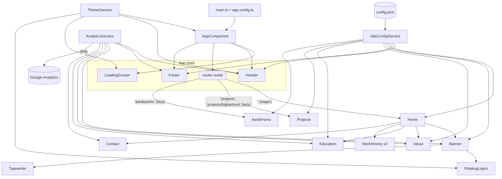

# Architecture



## Pieces

| Piece | Kind | What it does |
|---|---|---|
| `main.ts` + `app.config.ts` | Bootstrap | `bootstrapApplication(AppComponent)` with zoneless change detection, router, hydration, service worker |
| `LoadingScreenComponent` | Shell | Boot-time anime.js logo assembly |
| `HeaderComponent` | Shell | Nav bar, scroll effects, theme toggle |
| `FooterComponent` | Shell | Repo link, "built with" credit, design credits |
| `HomeComponent` | Page (eager) | Composes the home sections on `/` |
| `BannerComponent` | Home section | Greeting, typewriter, falling logos |
| `AboutComponent`, `EducationComponent`, `ContactComponent` | Home sections | Read copy from `SiteConfigService` |
| `WorkHistoryComponent` (x2) | Home section | One instance for work, one for volunteering |
| `ProjectsComponent`, `ProjectsHighschoolComponent` | Pages (lazy) | `/projects`, `/projects/highschool` |
| `AardeYamzComponent` + `NamecardComponent` | Page (lazy) | `/aardeyamz` |
| `SiteConfigService` | Service | The only reader of `config.json`, typed by `site-config.model.ts` |
| `ThemeService` | Service | `default` / `light` / `dark` as signals, saved in `localStorage`, applied as `[data-theme]` on `<html>` |
| `AnalyticsService` | Service | Calls the global `gtag()` for custom events |
| `ResumeService` | Service | Builds the résumé download link from `resume-manifest.json` |

## Routes

Defined in `src/app/app.routes.ts`; `src/app/app.routes.server.ts` lists the same paths for prerendering and must be kept in step.

| Path | Loaded | Component |
|---|---|---|
| `''` | Eager | `HomeComponent` |
| `projects` | Lazy | `ProjectsComponent` |
| `projects/highschool` | Lazy | `ProjectsHighschoolComponent` |
| `aardeyamz` | Lazy | `AardeYamzComponent` |
| `**` | | Redirects to `/` |

## Theme tokens

Colour tokens and logos come from the separate [yl-theme](https://github.com/AardeYamz/yl-theme) project, not this repo. `theme.json` pins a version and SHA-256; `scripts/fetch-theme.js` (run by the `pre*` hooks) downloads `yl-tokens.css`, the eleven logos, `logo-geometry.json` and the favicons from `theme.yannislam.org` into git-ignored `src/generated/`. `angular.json` loads the tokens as a global stylesheet. To change a token, change it in yl-theme, then here run `node scripts/fetch-theme.js --bump`, rebuild and commit `theme.json`.

## Code structure

```
docs/                         # change write-ups, plans, reviews
e2e/                          # Playwright specs + fixtures.ts
scripts/
├── generate-resume-manifest.js   # pre-hook: newest dated resume PDF -> resume-manifest.json
└── inject-env.js                 # postbuild: GA measurement ID into index.html
src/
├── app/
│   ├── animations/  components/{general,home,other}/  directives/
│   ├── icons/  pipes/linkify/  services/  utils/hydration.ts
│   └── app.config.ts  app.config.server.ts  app.routes.ts  app.routes.server.ts
├── assets/config.json        # All page content
├── generated/                # fetched from yl-theme (git-ignored)
└── styles.scss  bootstrap-custom.scss  fonts.scss  index.html  main.ts  main.server.ts
```

## Build hooks

- **`generate-resume-manifest.js`** runs before `start`, `build`, `watch` and `test`. It finds the newest `src/assets/resume/<name> YYYYMMDD.pdf` and writes it to `resume-manifest.json` (tracked in git; commit it with the new PDF).
- **`inject-env.js`** runs after `build` and replaces `%GOOGLE_ANALYTICS_ID%` in the built HTML. On Vercel a missing or malformed ID fails the build; elsewhere it writes the inert `G-XXXXXXXXXX` and warns. `ALLOW_MISSING_ANALYTICS=1` lets a fork opt out.
