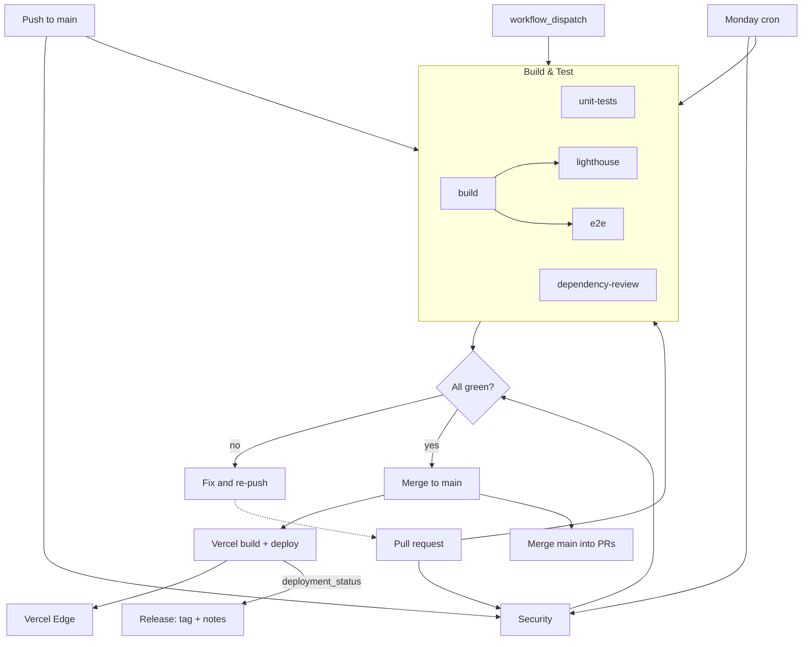
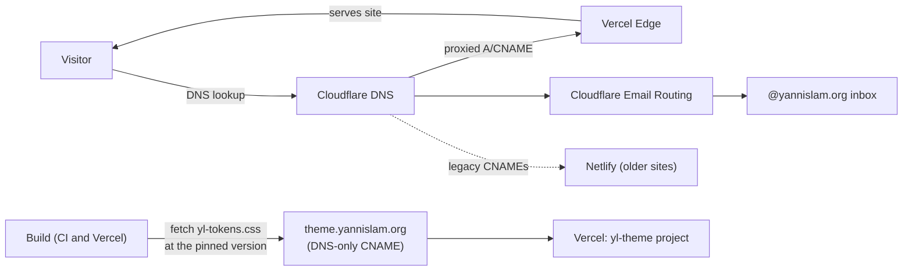

# CI/CD and Deployment

## Build & Test jobs (`build-test.yml`)

| Job | Runs on | Needs | What it does |
|---|---|---|---|
| `unit-tests` | Node 24.x and 26.x | | `npm ci`, Vitest in Playwright Chromium with coverage; Codecov upload from the 24.x leg |
| `build` | Node 24.x | | `npm run build`, prerendering every route; uploads the output as an artifact |
| `lighthouse` | `mobile`, `desktop` | `build` | Lighthouse CI against the build artifact |
| `e2e` | 2 shards | `build` | Playwright against the build artifact. PRs run Chromium and a mobile (Pixel 7) context and skip `@external`; pushes to `main` and the Monday run add Firefox and WebKit |
| `dependency-review` | PRs only | | Fails on `high` or above |

A newer push to the same PR cancels the older run. Pushes to `main` are never cancelled.

## Workflows

| Workflow | Trigger | What it does |
|---|---|---|
| Build & Test | PR to `main`/`master`/`develop`; push to `main`; Mondays 07:00 UTC; manual | The jobs above |
| Security | Same, Mondays 06:30 UTC | Lints workflow files with zizmor |
| Release | Vercel `deployment_status` | On a successful Production deploy of `main`, tags `vYYYYMMDD-HHMMSS` and creates a release |
| Merge main into PRs | Push to `main`; manual | Merges `main` into each open PR that is behind; comments once on conflicts; skips fork and Dependabot PRs |
| PR previews | PR open/sync/reopen/close | Builds the PR with `--base-href /pr-N/`, kept as artifact `pr-N-<sha>` for reuse |
| PR previews deploy | Dispatched by PR previews; manual | Publishes every open same-repo PR's newest build at `v3.yannislam.org/pr-N/` and comments the link |
| Dependabot auto-merge | `pull_request_target` | Waits for checks, then merges patch/minor bumps and dev-only majors; production majors wait for review |
| Vercel build warnings | Vercel `deployment_status` | Keeps a preview deploy's warning/error lines in a sticky PR comment |
| Dependabot | Mondays 06:00 UTC | Weekly `npm` and `github-actions` updates |
| CodeQL | Push, PR | GitHub default setup (no workflow file) |
| Vercel Git integration | Push to any branch | Production deploy for `main`, preview for other branches |

The Monday jobs are staggered (Dependabot 06:00, Security 06:30, Build & Test 07:00) so each sees what the one before produced.

## DNS and delivery

| Concern | Provider | Details |
|---|---|---|
| DNS zone | Cloudflare | `yannislam.org` |
| Site | Vercel | Proxied records point at Vercel Edge, serving `dist/v3.yannislam.org/browser` |
| Email | Cloudflare Email Routing | MX/SPF/DKIM/DMARC for `@yannislam.org` |
| Legacy sites | Netlify | `alpha.`, `v1.`, `v2.` still point at earlier versions |
| Theme tokens | Vercel (`yl-theme` project) | `theme.yannislam.org` must be reachable during a build |

## Dependency security

- **Dependabot** opens weekly version-update PRs (with a cooldown) and security-update PRs batched by the `security-updates` group.
- **Aikido** triages them by whether an advisory is reachable from shipped code. It runs as a GitHub App configured in the Aikido dashboard; there is no Aikido job or secret in the repo.

Bumps are grouped: `angular` (the `@angular/*` packages and tied libraries, which move together), `testing`, and a `minor-and-patch` catch-all. Other majors arrive one per PR. Angular majors are ignored by Dependabot and upgraded by hand with `ng update`.

## Security headers

`vercel.json` sets the response headers, including a `Content-Security-Policy-Report-Only`. A new third-party script, frame, image host or connection must be added to that policy.
