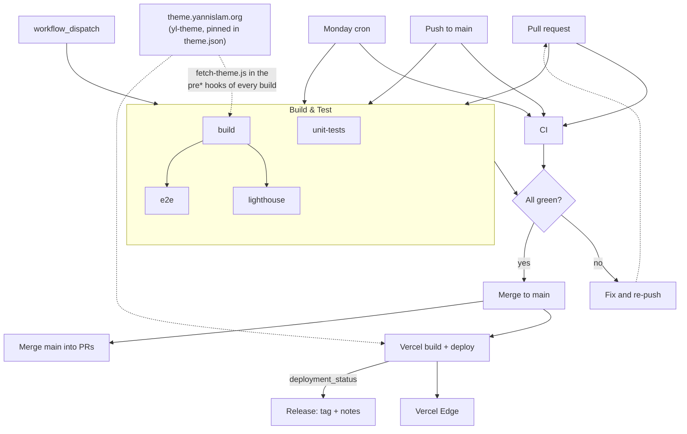

# CI/CD and Deployment

## Build & Test jobs (`build-test.yml`)

| Job | Runs on | Needs | What it does |
|---|---|---|---|
| `unit-tests` | Node 24.x and 26.x | | `npm ci`, then Vitest in Playwright Chromium with coverage; uploads to Codecov from the 24.x leg |
| `build` | Node 24.x | | `npm run build`, prerendering every route; uploads the output as an artifact |
| `build-warnings-comment` | Same-repo, non-Dependabot PRs | `build` | Keeps the build step's warning/error lines in one sticky PR comment |
| `lighthouse` | `mobile`, `desktop` | `build` | Lighthouse CI against the build artifact |
| `e2e` | 2 shards, `fail-fast: false` | `build` | Playwright against the build artifact (browsers cached on `package-lock.json`). PRs run Chromium and a mobile (Pixel 7) context and skip `@external`; pushes to `main` and the Monday run add Firefox and WebKit |

A newer push to the same PR cancels the older run
(`concurrency: cancel-in-progress`). Pushes to `main` are never cancelled.

## Workflows

| Workflow | Trigger | What it does |
|---|---|---|
| [Build & Test](https://github.com/AardeYamz/v3.yannislam.org/blob/main/.github/workflows/build-test.yml) | PR to `main`/`master`/`develop`; push to `main`; Mondays 07:00 UTC; manual | The jobs above |
| [CI](https://github.com/AardeYamz/v3.yannislam.org/blob/main/.github/workflows/ci.yml) | PR; push to `main`; Mondays 06:30 UTC; manual | One run of the shared `ci.yml`: diagram lint (mermaid and D2), actionlint, zizmor and dependency review (shared template). Checks are named `ci / <job>` |
| [Release](https://github.com/AardeYamz/v3.yannislam.org/blob/main/.github/workflows/release.yml) | Vercel `deployment_status` | On a successful Production deploy of `main`, tags `vYYYYMMDD-HHMMSS` and creates a release for that commit |
| [Merge main into PRs](https://github.com/AardeYamz/v3.yannislam.org/blob/main/.github/workflows/sync-prs.yml) | Push to `main`; manual | Merges `main` into each open PR that is behind; comments once on conflicts; skips fork and Dependabot PRs, and merges that would change `.github/workflows/` (shared template) |
| [PR previews](https://github.com/AardeYamz/v3.yannislam.org/blob/main/.github/workflows/pr-previews.yml) | PR open/sync/reopen/close | Builds the PR (and any open PR nobody has built yet) with `--base-href /pr-N/`, kept as artifact `pr-N-<sha>` for reuse (shared template) |
| [PR previews deploy](https://github.com/AardeYamz/v3.yannislam.org/blob/main/.github/workflows/pr-previews-deploy.yml) | Dispatched by PR previews; manual | Publishes every open same-repo PR's newest build together at `v3.yannislam.org/pr-N/` (separate static Vercel project), one deploy at a time, and comments the link (shared template) |
| [Dependabot auto-merge](https://github.com/AardeYamz/v3.yannislam.org/blob/main/.github/workflows/dependabot-auto-merge.yml) | `pull_request_target` | Waits for checks, then merges Dependabot patch/minor bumps and dev-only majors; production majors wait for review (shared template) |
| [Retry failed runs](https://github.com/AardeYamz/v3.yannislam.org/blob/main/.github/workflows/retry.yml) | Build & Test, CI, PR previews, PR previews deploy or Vercel build warnings finishing with a failure | Re-runs the failed jobs (up to 3 attempts, with backoff) only if one was lost with its runner (shutdown, lost contact); a real failure is left alone (shared template) |
| [Vercel build warnings](https://github.com/AardeYamz/v3.yannislam.org/blob/main/.github/workflows/vercel-build-warnings.yml) | Vercel `deployment_status` | Fetches a preview deploy's Vercel build log and keeps its warning/error lines in a sticky PR comment (needs `VERCEL_TOKEN`) |
| [Wiki sync](https://github.com/AardeYamz/v3.yannislam.org/blob/main/.github/workflows/wiki-sync.yml) | Push to `main` touching `wiki/`; manual | Mirrors `wiki/` into the GitHub wiki |
| [Dependabot](https://github.com/AardeYamz/v3.yannislam.org/blob/main/.github/dependabot.yml) | Mondays 06:00 UTC | Weekly `npm` and `github-actions` updates |
| CodeQL | Push, PR | GitHub default setup (no workflow file) |
| Vercel Git integration | Push to any branch | Production deploy for `main`, preview deploy for other branches |

Workflows marked *shared template* are short callers of the reusable workflows
in the public [AardeYamz/workflows](https://github.com/AardeYamz/workflows)
repo, pinned by SHA: change the logic there, not here.

The Monday jobs are staggered (Dependabot 06:00, CI 06:30, Build & Test
07:00) so each sees what the one before it produced.

## DNS and delivery

| Concern | Provider | Details |
|---|---|---|
| DNS zone | Cloudflare | `yannislam.org` |
| Site | Vercel | Proxied `A`/`CNAME` records point at Vercel Edge, which serves `dist/v3.yannislam.org/browser` |
| Email | Cloudflare Email Routing | MX/SPF/DKIM/DMARC for `@yannislam.org` |
| PR previews | Vercel (separate static project) | `v3.yannislam.org` is a DNS-only CNAME to Vercel and serves each open PR at `/pr-N/` |
| Legacy sites | Netlify | `alpha.`, `v1.` and `v2.` still point at earlier versions of the site |
| Theme files | Vercel (`yl-theme` project) | `theme.yannislam.org` is a DNS-only CNAME to Vercel. The build downloads the pinned theme files from it, so a build needs that host to be reachable |

## Dependency security

- **[Dependabot](https://docs.github.com/en/code-security/dependabot)** opens
  the bump PRs: weekly `npm` and `github-actions` version updates from
  `.github/dependabot.yml` (Mondays 06:00 UTC, with a cooldown), and security
  updates from the repository settings, batched by the `security-updates`
  group.
- **[Aikido](https://www.aikido.dev)** triages them: it checks whether an
  advisory is reachable from shipped code, so a critical advisory in an
  unreachable dev dependency doesn't drown out real ones. It runs as a GitHub
  App with PR gating set in the Aikido dashboard; there is no Aikido job or
  secret in this repo.

Bumps are grouped: `angular` (the `@angular/*` packages and libraries tied to
an Angular major, which must move together), `testing`, and a
`minor-and-patch` catch-all. Other majors arrive one per PR so each can be
reverted alone. Angular majors are ignored by Dependabot and upgraded by hand
with `ng update`.

## Security headers

`vercel.json` sets the response headers, including a `Content-Security-Policy-Report-Only`. A new third-party script, frame, image host or connection must be added to that policy.
